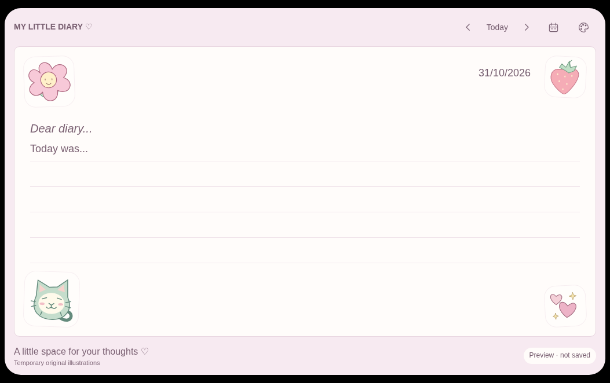
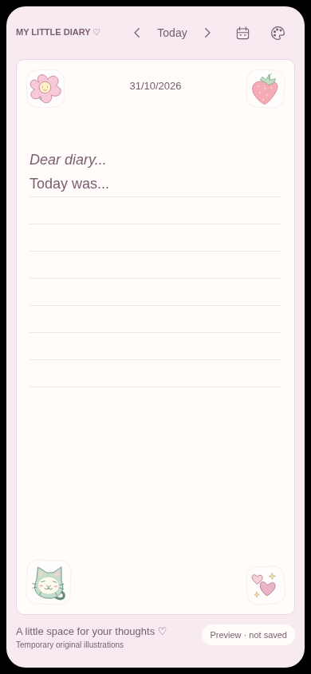

# Dear Diary Combined Implementation Report

Phase 4 Editor Architecture and Neon PostgreSQL Setup

Prepared 01/11/2026 · Asia/Kolkata · Owner review

The editor architecture is implemented locally, and the app has a verified server-side connection to Neon PostgreSQL. The final verification run passed 123 unit/integration tests and 60 production browser tests. The approved diary design and DD/MM/YYYY navigation are preserved.

Diary writing remains in memory. A successful database connectivity check does not save an entry. The interface continues to show **Preview · not saved**, and refresh or tab closure discards temporary writing.

## Current implementation status

| Area | Current status |
| --- | --- |
| Phases 1 through 3 | Approved and closed |
| Phase 4 editor architecture | Implemented and locally verified; awaiting owner review |
| Neon PostgreSQL setup | Separately authorized; initialization, deployment and live connectivity verified |
| Diary authentication | Unimplemented; Neon CLI sign-in authenticates the operator only |
| Diary entry persistence | Contracts defined; no production entry adapter, tables or mutations |
| Autosave and IndexedDB | Unimplemented; remain later-phase work |
| Git and remote CI | Changes remain uncommitted and unpushed; no new remote CI run |
| Frontend hosting | No frontend deployment performed |

The workspace is `/home/menma/Downloads/Diary`, branch `main`. HEAD remains `2210ef2b59bf4cd1299f370407176aa5d9e74ed6`, the approved Phase 3 commit. Its [Foundation checks run 41289750313](https://github.com/Menma420/Diary/actions/runs/41289750313) succeeded. That historical result does not verify the current uncommitted changes.

The controlling baseline is v1.1 together with later owner instructions. The explicit Neon request replaces the originally planned Supabase database for this connection setup. It enabled PostgreSQL only; no Neon Auth service or alternative diary login was introduced. The original PRD and approved Word plans remain unchanged. Existing Phase 4 work was preserved during Neon setup.

<!-- page -->

## Editor architecture and behavior

Phase 4 replaces direct mutation of textarea draft records with a small, React-independent model and controller. The existing persistent diary layout continues to own the workspace, so date navigation retains each date's document and editing position.

| Component or module | Responsibility |
| --- | --- |
| Date page and `DiaryPreview` | Date context, diary composition, navigation and guarded focus intent |
| `DiarySession` | Retain the in-memory editor workspace and separate theme state |
| `editor-model.ts` | Immutable plain-text state, invariants and explicit transitions |
| `editor-workspace.ts` | Independent date records, subscriptions and editing-session tokens |
| `useDiaryEditor.ts` | Connect React to the selected date and capture selection/scroll |
| `DiaryPaper` and `DiaryEditor` | Present the existing paper and handle controlled native textarea input |

The model reuses `CalendarDate`. A document contains only its date and text. Ready state includes an immutable baseline, local revision, selection range/direction, document scroll position, editable/read-only mode and idle/composing phase. Selection uses the textarea's UTF-16 offsets. The code preserves native text without trimming or introducing a rich-text format.

Lifecycle is **not-loaded → ready → disposed**. Initial load validates the document date. Loading a ready editor again is rejected, preventing an obsolete read from replacing current writing. Ordinary navigation disconnects its editing session and retains the document; it does not dispose of the draft.

| Event | Implemented behavior |
| --- | --- |
| `load` | Initialize once from a document or known missing result |
| `input` | Record exact text/selection; advance revision for changed content |
| `replace` | Explicitly replace all content and model the caret at its end |
| `clear` | Retain a present empty document instead of deleting its record |
| `position` | Capture valid selection and scroll without dirtying content |
| `mode` | Change editability without resetting content or position |
| `composition` | Track intermediate native input; block programmatic replacement while composing |
| `dispose` | End the pure-model lifecycle; unavailable as an ordinary workspace edit |

A missing document is `null`; an explicitly empty document contains `content: ""`. Dirty state compares both presence and exact text with the local baseline. It never implies a server acknowledgement. Invalid transitions return typed failure reasons and leave the previous state intact.

Each mounted editor has a token tied to its date. A replacement connection invalidates its predecessor, so stale input, blur or cleanup cannot change the replacement's draft. Theme changes retain the textarea node, focus and selection. Date revisits restore the correct text, selection direction and scroll while respecting a newer deliberate focus choice. Long writing grows the document without nested editor scrolling.

<!-- page -->

## Persistence and save contracts

The editor owns editing behavior; future adapters own persistence. The live Neon connection is not connected to the `EntryPersistence` interface and does not read or write diary entries.

`EntryPersistence` defines `read(date)` and `write(date, request)`. A future implementation must be scoped to the verified diary owner. Client-supplied ownership is rejected by the request schema. Reads distinguish a successful missing entry from a failed request: missing means `exists: false`, empty text and version 0; an existing empty entry has `exists: true` and a positive version.

Writes contain exact content, a base version and UUID mutation ID. An immutable mutation snapshot also captures its date and local revision. Validators reject mismatched response dates, acknowledgements with the wrong date/ID/version, unsafe numeric versions and invalid IDs. Server content contracts enforce the planned 256 KiB UTF-8 limit and reject null characters without trimming text. Fake-adapter tests exercise the interface; no production entry adapter or server save engine is active.

### Future server save states

| State | Meaning |
| --- | --- |
| `not-loaded` | No authoritative entry result is available |
| `loading` | An authoritative read is pending |
| `unchanged` | A result is loaded without subsequent edits |
| `unsaved` | The current revision lacks server acknowledgement |
| `saving` | A particular immutable mutation remains unresolved |
| `saved` | A matching acknowledgement covers the latest local revision |
| `save-failed` | Preserve text and exact unresolved mutation metadata |
| `conflict` | Preserve local and remote versions for a later deliberate decision |

These are contracts for future integration. An older acknowledgement must not mark newer text saved or replace editor content. A future device transaction may mean “Draft stored on this device”; it cannot produce the server Saved indicator.

### Recovery boundary

The version 1 recovery record contains the owner/date/writer key, latest text and local revision, base server version, update timestamp and optional exact unresolved mutation. Newer text and an older pending snapshot are retained separately. Local drafts can retain text that server validation rejects, including oversized content, so validation cannot silently destroy writing.

`RecoveryStorage` defines owner-scoped enumeration, ordered transactional commits and conditional acknowledgement/cleanup. Older commits cannot regress revisions or resurrect an acknowledged mutation. Cleanup may remove a record only when the latest revision is acknowledged. Timestamps never select a winning draft. IndexedDB, reconciliation, actual transactional ordering and storage-failure handling remain unimplemented.

Future authentication must supply a verified owner before entry persistence is connected. The Neon operator login and pooled database credentials do not authenticate a diary user. The later schema, authorization and atomic-save design must account for Neon PostgreSQL rather than assuming Supabase-specific database authentication context.

<!-- page -->

## Neon configuration and dependencies

The requested initialization and deployment targeted the existing project and production branch. No second project or development branch was created.

| Configuration | Value or purpose |
| --- | --- |
| Organization | `org-blue-night-62231221` |
| Project | `spring-bar-19934102` — Diary |
| Branch | `production` / `br-holy-heart-b4yqhxus` |
| Utilized service | PostgreSQL only |
| Policy | `neon.ts`; existing branch already matched it |
| App connection | Pooled `DATABASE_URL` |
| Future migration connection | `DATABASE_URL_UNPOOLED`; unused by the app |
| Branch metadata | `NEON_BRANCH` |

Neon pulled the three variables into ignored `.env.local`, retaining the existing origin/timezone. Local environment permissions are 0600. `.neon` is ignored local project metadata. No connection strings, passwords or tokens are included in this report or browser responses.

The new `postgres.server.ts` module is protected with `server-only` and validates configuration through `@neon/env`. It creates a pool lazily, so builds do not contact the database. The pool has at most two connections, ten-second connection/query timeouts, certificate/hostname verification with `sslmode=verify-full`, and channel binding enabled. It caches only connections, never diary content or user identity. Vercel's lifecycle helper is attached when the Vercel runtime is detected; production Vercel hosting has not been tested.

`GET /api/health/postgres` runs only `SELECT 1::integer AS connected` and checks the returned value. It returns connected/unavailable status without database identity or raw driver errors, uses private/no-store responses, and returns HTTP 503 on failure. This is the only active database query added to the application.

| Added dependency | Pinned version | Purpose |
| --- | --- | --- |
| `@neon/config` | 1.10.0 | Neon policy |
| `@neon/env` | 1.6.8 | Injected environment validation |
| `pg` | 8.23.1 | Server PostgreSQL driver |
| `@vercel/functions` | 3.10.5 | Pool lifecycle on Vercel |
| `@types/pg` | 8.23.1 | Development-only TypeScript definitions |

Runtime remains Node 24.22.1 and pnpm 12.8.1. Neon CLI is 8.16.0. Phase 4 itself added no dependencies; these additions belong to the subsequent Neon task. Existing direct Next.js, React, TypeScript, Vitest and Playwright versions remain pinned, and no npm lockfile was introduced. The CLI also installed global Neon agent tooling.

<!-- page -->

## Verification results and command evidence

| Check | Phase 4 result | Final result after Neon wiring |
| --- | --- | --- |
| Unit/integration tests | 116 passed in 8 files | **123 passed in 9 files** |
| Production browser tests | 60 passed | **60 passed** |
| Lint and strict TypeScript | Passed | Passed |
| Production build | Passed | `npm run build` passed |
| Accessibility | Zero axe violations | Zero axe violations in the existing suite |
| Public output scan | 27 assets/payloads | 27; configured database credentials absent |
| Real database connection | Not part of Phase 4 | HTTP 200 after real PostgreSQL `SELECT 1` |
| Peer dependencies and whitespace | Passed | Passed |

The final 123-test count includes the earlier 116 tests plus seven new PostgreSQL configuration/health-route cases; the counts must not be added together. The browser suite covers desktop, 320 px and 390 px Chromium, all four themes, calendar focus, navigation/history, isolated drafts, selection/scroll, native paste/undo, long writing, overflow and reflow. Its 24 axe scans cover the diary and open calendar in all four themes across three projects.

The deployment command completed successfully. PostgreSQL was already present:

```text
No changes — branch production already matches the policy.
Utilized services: Postgres
Pulled 3 Neon variables into .env.local
```

Recorded `npm run build` output included:

```text
> dear-diary@0.1.0 build
> next build
✓ Compiled successfully in 3.2s
  Finished TypeScript in 3.4s ...
✓ Generating static pages using 7 workers (2/2) in 370ms
```

The production app was started with `npm run start -- --port 3100`. Actual `npm run neon:check` output:

```text
GET /api/health/postgres: HTTP 200
{"status":"ok","services":{"postgres":"connected"}}
PASS: running Next.js route executed the read-only PostgreSQL SELECT 1 check.
PASS: diary HTTP 200; configured database credentials absent from rendered HTML.
```

This traversed the running HTTP server, Next.js handler and real `pg` driver. It proves the configured service is reachable; it does not prove diary entry persistence or owner authorization. Full setup commands and build output are retained in the [Neon setup report](neon-setup-report.md).

<!-- page -->

## Visual preservation and evidence

The Phase 4 production captures retained the approved paper, Sakura palette, typography, corners, controls and truthful status. Desktop, 390 px and 320 px Sakura PNGs were byte-identical to the approved Phase 3 captures. The desktop paper remained 1005 × 502 px at (24, 80), with 44 px rules; mobile retained 34 px rules. All six captures had no browser errors or horizontal overflow.



Desktop production capture at 1053 × 662 px.



Mobile production capture at 390 × 844 px.

The Neon task changed no editor or visual implementation file. Twenty-one existing editor-related files were compared byte-for-byte with the pre-Neon private backup, with no differences. The final browser suite also passed after Neon wiring. The displayed captures are Phase 4 evidence; they were not recaptured for this combined report.

Additional evidence: [320 px mobile](../artifacts/phase-4/mobile-320.png), [Dreamy Sky](../artifacts/phase-4/dreamy-sky.png), [Lavender Dreams](../artifacts/phase-4/lavender-dreams.png), [Vintage Journal](../artifacts/phase-4/vintage-journal.png), and [geometry and hashes](../artifacts/phase-4/layout-metrics.json).

<!-- page -->

## Combined file inventory

The following inventory is relative to the approved Phase 3 commit. It includes earlier Phase 4 work and the subsequent Neon setup. It does not imply that all files changed during Neon wiring.

### Modified files

- `.env.example`
- `.gitignore`
- `README.md`
- `package.json`
- `pnpm-lock.yaml`
- `scripts/check-client-output.mjs`
- `src/components/diary/DiaryPaper.tsx`
- `src/components/diary/DiaryPreview.tsx`
- `src/components/diary/DiarySession.tsx`

### Created implementation and test files

- `neon.ts`
- `src/lib/diary/editor-model.ts`
- `src/lib/diary/editor-workspace.ts`
- `src/lib/diary/persistence-contracts.ts`
- `src/lib/postgres-config.ts`
- `src/lib/postgres.server.ts`
- `src/components/diary/DiaryEditor.tsx`
- `src/components/diary/useDiaryEditor.ts`
- `src/app/api/health/postgres/route.ts`
- `tests/unit/editor.test.ts`
- `tests/unit/editor-component.test.tsx`
- `tests/unit/persistence-contracts.test.ts`
- `tests/unit/postgres.test.ts`
- `tests/e2e/editor.spec.ts`
- `scripts/capture-phase-4.mjs`
- `scripts/check-neon.mjs`

### Created reports and review evidence

- `docs/phase-4-report.md`
- `docs/neon-setup-report.md`
- `docs/phase-4-neon-combined-report.md`
- `documents/Dear_Diary_Phase_4_and_Neon_Combined_Report.docx`
- `artifacts/phase-4/desktop.png`
- `artifacts/phase-4/mobile.png`
- `artifacts/phase-4/mobile-320.png`
- `artifacts/phase-4/dreamy-sky.png`
- `artifacts/phase-4/lavender-dreams.png`
- `artifacts/phase-4/vintage-journal.png`
- `artifacts/phase-4/layout-metrics.json`

No files were deleted. Ignored `.neon` and `.env.local` were created/updated locally. Existing approved Word planning documents, Phase 2/3 evidence, CSS, illustrations and GitHub workflow were preserved. No app code changed while preparing this combined report.

<!-- page -->

## Resolved setup failures and remaining limits

The initial Neon login failed with `invalid_grant`. The user's shell selected Neon 5.0.0, while an earlier installation had updated a different Node runtime. The relevant CLI installations were upgraded to 8.16.0, the user completed browser sign-in, and the DEFAULT OAuth session was verified before setup resumed.

An authenticated initialization then linked the project and pulled environment variables, but its skills installer failed under Node 20.20.2. Re-running the requested initialization using the app's Node 24.22.1 runtime succeeded and preserved the generated policy. The pre-existing ESLint deprecation notice did not fail verification. No unresolved setup, build or connectivity failure was reported by the completed runs.

Writing is still volatile. The workspace retains visited dates during its mounted tab/layout lifetime, without eviction, and memory can grow with usage. Refresh, tab closure or a full document reload discards drafts. There is no durable local buffer, cross-device synchronization or production save guarantee.

Composition was tested through DOM events, and browser tests used Chromium emulation. Real OS IME, iOS Safari/Android keyboard, screen-reader and production Vercel verification remain outstanding. Native undo across dates, remounts or reloads is not promised. The connection pool's Vercel path is prepared but was tested locally through the ordinary Node server.

### Remaining inputs and implementation work

The owner email and account-recovery responsibility are needed before diary authentication provisioning. Verified-owner authorization must precede entry persistence. Later work must implement the Neon-compatible schema, permissions, version-checked atomic writes, exact mutation retries, save engine and mandatory IndexedDB reconciliation against the established contracts.

Final illustration rights/assets remain a later acceptance item. Hosting budget, regions, backup retention, acceptable data-loss window and restoration-time target remain production-provisioning decisions. Neither the CLI account nor a successful health probe resolves those requirements.

### Owner review checklist

- [ ] Accept the Phase 4 model, transitions, editing behavior and contract boundaries.
- [ ] Confirm the unchanged diary presentation and navigation are accepted.
- [ ] Acknowledge that Neon connectivity is verified while diary writing remains unsaved.
- [ ] Authorize commit/push and exact-commit remote CI verification if desired.
- [ ] Separately authorize Phase 5 before authentication work begins.

The working tree contains the local implementation and reporting changes. Nothing has been committed or pushed. No frontend deployment was performed, and no Phase 5 authentication or Phase 6 diary persistence was implemented. The latest approved remote CI result remains the Phase 3 run linked at the beginning of this report.

The last verified local preview is [http://127.0.0.1:3100/](http://127.0.0.1:3100/). Runtime commands and troubleshooting are in the [README](../README.md).

### Source reports and technical references

Source handoffs: [Phase 4 editor architecture](phase-4-report.md), [Neon setup and verification](neon-setup-report.md), and [Phase 3 implementation](phase-3-report.md).

Technical references: [Neon connection methods](https://neon.com/docs/connect/choose-connection), [Neon Vercel guidance](https://neon.com/docs/guides/vercel-connection-methods), [node-postgres SSL](https://node-postgres.com/features/ssl), and [node-postgres pooling](https://node-postgres.com/apis/pool).
