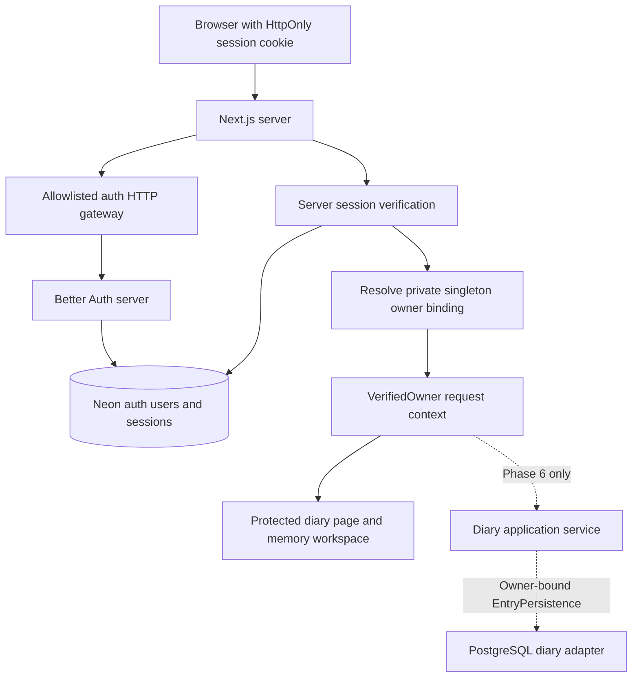

# Dear Diary Phase 5 Authentication and Verified Ownership Proposal

Prepared 01/11/2026, Asia/Kolkata. Status: proposed architecture awaiting owner approval. Planning only.

## Recommendation and decision requested

Use **self-managed Better Auth on the existing Next.js Node server**, backed by the existing Neon PostgreSQL service. Prefer email and password initially, with verified email and controlled password recovery; passwordless email codes are a supported alternative if the owner prefers them. Activate only the selected login method. Preserve server-managed HttpOnly cookies and closed registration.

This recommendation adds an authentication library, not a second application server or a new managed identity platform. Neon remains the database provider. Leave managed Neon Auth disabled. Better Auth's documented Next.js integration and direct `pg` support fit the current stack without an ORM. Its documented signup controls and HttpOnly cookie model satisfy the approved constraints. The operator must accept responsibility for security updates, schema maintenance and email delivery. [Next.js integration](https://better-auth.com/docs/integrations/next), [PostgreSQL adapter](https://better-auth.com/docs/adapters/postgresql), [cookie security](https://better-auth.com/docs/reference/security).

Clerk is a credible managed alternative if operational convenience is more important and the owner explicitly accepts a change to the approved cookie architecture. Neon Managed Better Auth remains a candidate if a supported server-side closed-registration control can be established. Neither alternative is silently selected or enabled.

Approval is requested for this design, the login method, recovery ownership and an operating-cost ceiling before implementation. No account, dependency, schema, environment or application changes were made for this proposal. It does not authorize Phase 6 or deployment.

## Inspected baseline and existing boundaries

The workspace is `/home/menma/Downloads/Diary`, on `main` at `1fa865fbfd628837aea79742e4d3bd69ca1712a7`. It was clean at inspection. The previous exact-commit [Foundation checks run 41294968901](https://github.com/Menma420/Diary/actions/runs/41294968901) passed; this proposal makes no new runtime-verification claim.

Reviewed the original PRD, approved v1.1 baseline, technical and phase plans, Phase 1–4 handoffs, Neon report/final audit, application routes, installed Next.js authentication guidance, editor/session implementation, environment validation, pool and persistence contracts.

| Existing implementation | Implication for Phase 5 |
| --- | --- |
| Next.js 16.4.3, React 19.3.1, Node 24.22.1, strict TypeScript | Select and pin a compatible maintained auth release after approval; installed-version validation remains necessary |
| `/` and `/diary` redirect dynamically to today's Kolkata date | Authenticate before protected rendering; preserve request-time Today and DD/MM/YYYY URLs |
| Date layout validates params; date page renders `DiaryPreview` | Add independent owner checks near rendering, without changing date arithmetic or navigation |
| `DiarySession` owns the mounted tab's `EditorWorkspace` | Keep the workspace alive across date changes and same-owner reauthentication; do not add auth logic to editor transitions |
| No `proxy.ts`, middleware or auth routes | No existing identity implementation needs replacement |
| Pool is server-only; only SQL is a fixed health probe | Reuse connection configuration/lifecycle; auth persistence must remain separate from future diary operations |
| `neon.ts` has `auth: false` | CLI sign-in is operator access; no diary-user authentication is active |
| `EntryPersistence.read(date)` and `write(date, request)` | Bind a verified owner on the server without adding browser ownership fields |
| Recovery record requires an owner UUID | Preserve a stable internal UUID independently of provider-specific subject formats |
| Legacy environment validation groups `OWNER_USER_ID` with Supabase fields | Do not set that variable and accidentally require Supabase; replace the legacy auth boundary deliberately during the approved implementation |

Historical documents mention Supabase, ISO URLs and earlier pre-commit states. Later approvals control Neon and DD/MM/YYYY. The original plans also require server-managed HttpOnly cookies and a private singleton owner configuration. This proposal preserves those safeguards while proposing a new auth library and an explicit identity mapping. The approved source documents remain unchanged.

## Provider comparison

The following are documented capabilities or stated uncertainties; operational judgments are recommendations for this diary, not provider guarantees.

| Criterion | Clerk | Better Auth self-managed | Auth.js | Neon Managed Better Auth |
| --- | --- | --- | --- | --- |
| Next.js App Router | Dedicated Next.js SDK | Documented Next.js handler/server integration | Next.js integration through `next-auth` | Documented Neon Next.js SDK |
| Neon compatibility | Independent identity service; diary DB stays Neon | Direct PostgreSQL `pg` integration | Official Neon adapter | Auth state lives in the Neon branch |
| Server verification | Server `auth()`; live provider checks where current revocation matters | Opaque session checked against the auth DB | Server `auth()`; session strategy determines revocation behavior | Managed session verification; exact SDK/cache behavior must be validated |
| Cookies | Application `__session` token is JavaScript-readable | HttpOnly cookies; production Secure and SameSite controls | Server cookie sessions; configuration depends on strategy | Next.js server integration exists; validate its cookie contract |
| Single-owner provisioning | Manual creation or one invitation, then immutable subject allowlist | Private one-time bootstrap and singleton owner binding | Provision identity and enforce callbacks/application owner binding | Managed admin capability; provisioning and registration closure need validation |
| Public signup | Invite-only mode; still enforce owner authorization | Disable signup, block unused paths and deny web user creation | Reject unwanted sign-ins/account creation explicitly; email flow can create accounts | Full closure was not verified in reviewed public docs |
| Password / passwordless | Both managed experiences | Password/reset or optional email OTP/magic-link plugin | Credentials or email provider | Password, email OTP and magic link are documented |
| Recovery | Managed account flows; operator escalation remains necessary | Library reset flows plus operator-owned email/recovery procedure | More application work, especially password recovery | Managed reset/email delivery; production SMTP required |
| Maintenance | Lowest app-side auth infrastructure burden | App owns patches, auth tables, mail and abuse controls | App owns integration, adapters and more credential logic | Managed auth operations; narrower configuration/plugin surface |
| Migration | External subjects and credential export constraints | Auth rows under operator control; sessions still require planned cutover | Adapter/provider-dependent migration | Auth state branches with DB; managed service and SDK coupling |

Clerk's invite-only mode supports manually created or invited users. The allowlist feature is a different control with production paid-plan requirements; it must not be confused with invite-only mode. Its normal application session cookie cannot meet this baseline's HttpOnly requirement without changing the integration design. A custom token-exchange/session bridge would add another session system and is not recommended here. [Access restrictions](https://clerk.com/docs/guides/secure/restricting-access), [Clerk cookie limitation](https://clerk.com/docs/guides/secure/best-practices/xss-leak-protection), [App Router support](https://clerk.com/docs/nextjs/getting-started/quickstart), [server auth](https://clerk.com/docs/reference/nextjs/app-router/auth).

Better Auth documents `emailAndPassword.disableSignUp`, disabled auth paths, and prevention of automatic signup in the optional email-OTP and magic-link plugins. A hidden signup button alone is insufficient. These explicit server controls are the principal reason to choose it. [Options](https://better-auth.com/docs/reference/options), [email OTP](https://better-auth.com/docs/plugins/email-otp), [magic links](https://better-auth.com/docs/plugins/magic-link).

Auth.js supports Next.js and has a Neon adapter. Its credentials provider leaves password storage, rate limiting and recovery logic to the application; its email provider requires database verification records and can register users through the sign-in flow. Those paths need explicit owner restrictions. The official site now places Auth.js under Better Auth and describes its `next-auth` documentation as v5 beta and later; this is not evidence that existing Auth.js installations are unsafe or abandoned. For this new installation, Better Auth requires less custom credential/recovery work. [Auth.js overview](https://authjs.dev/getting-started), [credentials responsibilities](https://authjs.dev/getting-started/authentication/credentials), [email flow](https://authjs.dev/getting-started/authentication/email), [Neon adapter](https://authjs.dev/getting-started/adapters/neon).

Neon's managed service has a concrete advantage: identity/session state stays in the same branching platform. However, the reviewed production checklist describes signup as open by default, and the reviewed configuration/plugin guidance did not establish a complete supported registration-disable policy for all enabled flows. This is an unresolved verification point, not a claim that the service can never restrict signup. An application owner check would protect the diary but would not by itself disable public account creation at a remotely callable auth service. Do not enable it on that assumption. [Managed service](https://neon.com/docs/auth/about), [production checklist](https://neon.com/docs/auth/production-checklist), [managed plugins](https://neon.com/docs/auth/guides/plugins).

## Authentication and request flow

For anonymous `/` or `/diary` requests, redirect to `/login` without rendering the editor or private RSC payload. On a dated diary route, return a login-only gate at that URL when authorization is missing. Using the same gate for direct and client navigation avoids a redirect that could destroy an already mounted draft workspace. Accept only a validated canonical diary return path; otherwise use today's Kolkata route. Reject absolute/protocol-relative URLs, backslashes, encoded separators and control characters. Never echo a token into a redirect.

For the recommended password flow, the owner submits email/password to the same-origin server. The auth gateway validates input, request origin and permitted route/method, applies durable limits, then invokes the library's HTTP handler. Better Auth verifies credentials and creates its session. A session-creation hook independently permits only the configured owner account. The gateway preserves library `Set-Cookie` headers but returns a minimal success/error response, not raw token/session JSON. The server then verifies the session and resolves ownership before allowing the diary. Better Auth documents before-hooks for user/session creation, including aborting an operation; validate the exact pinned implementation before relying on them. [Database hooks](https://better-auth.com/docs/concepts/database#database-hooks).

Do not expose the library's entire endpoint surface by default. Only the selected login, verification, recovery, session and logout operations are allowed. Reject signup, account deletion, email changes, account linking, social/anonymous login and admin APIs unless separately approved. Keep provider tokens, session IDs and credential-bearing library responses out of RSC/client props and browser-accessible session JSON. Do not disable library origin/CSRF protections to make a custom form work.

If passwordless email is selected instead, recommend a short email code rather than enabling both codes and magic links. This avoids link-scanner consumption and gives the owner an explicit browser confirmation step. Disable automatic signup, deliver only to the provisioned account, use hashed OTP storage, short expiry and an attempt cap. Exact plugin behavior and response sanitization must be exercised against the pinned release. No passwordless plugin is needed for the password-only choice.

## Controlled owner provisioning and identity mapping

Retain **one private singleton configuration row**, not a users/profile/roles subsystem. Proposed logical fields are a singleton key, stable `owner_id` UUID, and the permitted Better Auth user ID. Constrain the row to one binding, reference the actual auth user and allow only operator tooling to create/change the mapping. The runtime can read it but cannot rebind ownership. A missing or inconsistent row denies all diary access.

The internal UUID exists because Phase 4 recovery contracts require UUID ownership while an auth provider's identifier can be opaque text. Future diary rows reference this stable internal UUID. It is not a second credential/profile record: name, email, password and verification state remain with Better Auth. No organizations, tenant memberships, role hierarchy, dynamic owner selection or browser owner-administration UI is needed.

After separate provisioning authorization:

1. Obtain the owner-confirmed email through the agreed setup process. Never infer it from Git metadata, Neon operator identity or a pasted example.
2. Generate/review auth-only migrations and the singleton constraint in an isolated environment. Public registration stays disabled throughout.
3. Run a private, one-time server bootstrap command, using the selected library's supported account-creation API in a process that exposes no HTTP handler. If the API requires signup enabled, enable it only inside that isolated bootstrap instance; the deployed web configuration remains closed. Abort if an owner binding already exists.
4. Generate the stable owner UUID and bind it to the returned auth user. Until that binding is complete, the web application remains fail-closed. Do not mark email verified merely because the operator typed it.
5. Send a provider-supported verification/credential-setup email. Do not print, email or commit an initial plaintext password. If a temporary random password is needed internally, keep it transient, hash through the library and let the owner replace it through recovery.
6. Verify mailbox control, owner login, direct signup denial, and rejection of a second synthetic identity. Retire bootstrap privileges from the runtime. Do not leave an administrative provisioning route or a deployed bootstrap flag.

If bootstrap partially succeeds, leave the diary inaccessible and reconcile the specific auth account before retrying. Never overwrite an existing owner binding or delete unrelated records as cleanup. This process is a proposal; no owner account or UUID has been created.

## Ownership checks and future persistence

Introduce one server-only `requireOwner()` helper. It verifies the current opaque session against the authoritative auth database, checks expiration and email verification, and resolves the user ID through the singleton binding. Return a small immutable `VerifiedOwner` context, constructed only within this server boundary. Request-local deduplication is acceptable; process-global user/session caches are not. A TypeScript brand helps prevent accidental misuse but is not a security boundary.

Do not grant access solely because an email matches, a cookie exists, a client hook says signed-in, or a request contains an `ownerId`. Even a valid second account must be rejected. Never take ownership from URL/query/form/JSON fields or forwarded identity headers.

The Phase 6 boundary remains:

1. Authentication adapter verifies session and returns identity.
2. Owner resolver yields the authorized internal UUID.
3. Diary service validates the date/content/version/mutation request.
4. A server-created owner-bound adapter implements the existing `EntryPersistence` interface.
5. Every diary SQL operation includes that bound owner; future atomic functions enforce it with restricted grants.

No `ownerId` parameter needs to be added to public `read(date)` or `write(date, request)`. A server factory can close over `VerifiedOwner`. Do not export a preauthorized repository singleton: each independent read/write must obtain current authorization. Authentication failures map to the contract's unauthenticated/forbidden result; they must never become successful missing entries.

The pooled connection authenticates a database role, not the diary user. Do not assume `auth.uid()` or Supabase RLS context exists. A future transaction-local identity mechanism, if used, must be set from verified server context within the same transaction, never from browser input or persistent pool-session state. Phase 6 must separately prove grants, cross-owner denial, atomic version checking and exact retries. No such implementation belongs in Phase 5.

## Routes and server protection

| Proposed route/surface | Access and handling |
| --- | --- |
| `/login` | Public; minimal Sakura-themed login, no diary content or public signup |
| Password verification/recovery pages | Public token-validation surfaces only; activate only the selected flow |
| Allowlisted `/api/auth/...` operations | Public entry points for authentication, with CSRF/origin/rate controls; logout requires a session |
| Minimal session-status endpoint | Publicly callable but returns only anonymous/verified-owner status and required expiry metadata; no token, owner email or provider record |
| `/`, `/diary`, `/diary/DD/MM/YYYY` | Owner check before private rendering; dated routes use an inline denial/login gate; authenticated canonical date behavior retained |
| `/api/health/postgres` | Recommend owner protection before deployment, preventing anonymous database wakeups; keep sanitized success/failure responses |
| Future entry/preferences APIs and Server Actions | Each performs independent owner authorization; not implemented in Phase 5 |
| Static CSS, fonts and decorative assets | Public, containing no user data |

Use Next.js 16 `proxy.ts` only for early redirects, response policy and optional cookie-presence optimization. It is not authorization. Recheck in the date page, any private server component and every protected handler/action. A check in the persistent layout alone does not rerun on every navigation or secure other entry points. The installed Next.js 16.4.3 guide and [official authentication guidance](https://nextjs.org/docs/app/guides/authentication) explicitly caution about these boundaries.

Unauthenticated APIs return 401; an authenticated non-owner returns generic 403; auth/owner-store failures return sanitized 503. Pages render no diary/editor payload on failure. An unavailable provider/database is not a successful anonymous session and must not create an editable empty entry. Owner-only routes and RSC responses use private/no-store behavior with framework-appropriate Vary/cache handling; public CDN caching is forbidden.

## Session lifecycle and writing continuity

Proposed policy: database-backed sessions, cookie cache disabled, a fixed seven-day maximum lifetime and automatic rolling renewal disabled. Renewal requires successful reauthentication and creates a fresh session; do not invent custom refresh tokens. This simple policy avoids relying on Server Components to set renewal cookies. Cookie setting/clearing happens through supported handlers. These durations are recommendations, not claims about installed settings. Better Auth documents database checks, explicit refresh settings and cache-related revocation delay. [Session management](https://better-auth.com/docs/concepts/session-management).

Check current status on tab focus/restoration, at known expiry and after authorization failures. Do not add continuous diary polling. On detected expiry, pause editing and lock the visible paper without disposing of the memory workspace; show a small same-origin reauthentication dialog in the mounted page. After the same owner is verified, restore that date's content/selection/scroll while honoring a newer deliberate focus choice. A hard redirect, refresh or tab closure still loses Phase 5 memory, so do not use one as the normal reauthentication path.

An expiry check before navigation can race with server verification. Therefore the dated server page must return a typed unauthenticated/unavailable gate, rather than a hard login redirect, on a denied navigation. Keep the already authorized owner's `DiarySession` above that route boundary while locking its children. Initial anonymous visitors receive only the login gate and no initialized private workspace. Never key the workspace by a transient signed-in boolean or session token; same-owner renewal must not remount it. Test expiry between clicking Next and receiving its RSC response, followed by same-owner login and return to both dates. This lifecycle detail is necessary to preserve the Phase 4 draft invariant.

A revoked session is rejected on the next authoritative server check. An already downloaded page cannot be made secret retroactively; without continuous polling/push, remote revocation may not immediately hide an idle tab. The lock is a usability/privacy measure, not encryption against a compromised browser. Another identity must never receive the retained owner workspace.

For explicit logout while text exists, warn that this phase cannot save it. Offer Cancel or deliberate discard and sign out, giving the owner an opportunity to copy text first. Do not pretend to flush writing. On successful revocation, clear cookies and private memory and ensure Back/Forward restoration rechecks auth. If revocation fails, report that server logout is unconfirmed; lock the UI and retain memory for retry. A separately confirmed local discard/sign-out may clear local state, but must not be presented as confirmed global revocation. Other open tabs lock/clear on their next session check. Phase 6 must replace this temporary logout limitation with the approved flush/recovery choices.

Keep all existing theme/date/editor behavior inside the verified workspace. Add only the necessary quiet logout action and login/expiry surfaces; submit their placement for visual review. No dashboard, sidebar, rich editor, new theme or stationery redesign is proposed. Keep **Preview · not saved** until real entry persistence exists.

## Security responsibilities and threats

| Threat or boundary | Library responsibility | Application/operator responsibility |
| --- | --- | --- |
| Credential theft/session forgery | Password hashing, session generation/verification primitives | HTTPS, secret isolation, no raw auth objects in responses/logs, pin and patch the library |
| XSS/token access | HttpOnly session-cookie support | Render diary text as text; restrict scripts, framing and referrers; no session replay/content analytics |
| CSRF/login CSRF | Origin/Fetch Metadata protections on supported HTTP handlers | Fixed trusted origin, same-origin mutations, preserve checks when wrapping handlers; no wildcard production trust |
| Unauthorized owner | Authenticated identity only | Singleton resolution on every protected operation; reject browser ownership and non-owner sessions |
| Brute force/email abuse | HTTP rate-limiter and endpoint/plugin limits | Enable durable storage, tune limits, trust only hosting-supplied client-IP headers, monitor redacted failures |
| Recovery compromise | Verification/reset/OTP primitives | Verified mailbox, operator identity checks, session revocation and tested recovery runbook |
| Leaks through caching/history | No automatic diary privacy guarantee | Private/no-store, no authenticated static prerendering, lifecycle locks and browser-restoration tests |
| Auth/database outage | Error reporting primitives | Fail closed, preserve unresolved memory, bounded waits and sanitized 503 rather than a blank editor |

Set production cookies to HttpOnly, Secure, host-only, Path `/`, SameSite Lax and explicit expiry. Do not share auth cookies across subdomains. Use a host-prefixed name where supported by the pinned release. Allow non-Secure cookies only for local loopback development. No session tokens in LocalStorage, SessionStorage, IndexedDB or client props. HttpOnly reduces token theft but does not prevent an active XSS from acting as the user.

Retain Better Auth's trusted-origin and CSRF checks. For custom server API calls, explicitly supply/validate request context: the library's HTTP protections cannot simply be assumed to cover arbitrary wrappers. Its documented rate limits do not apply to direct server-side `auth.api` calls. Prefer the HTTP-handler gateway for public login requests; any exception needs equivalent app-side protections and tests. [Security controls](https://better-auth.com/docs/reference/security), [rate-limiter boundaries](https://better-auth.com/docs/concepts/rate-limit).

Use database-backed auth rate limits rather than a per-process memory counter on serverless hosts. Initial proposed limits are five password attempts per IP per minute, three recovery-email requests per IP per fifteen minutes, and bounded verification attempts; tune after tests. An account/destination send budget must also prevent distributed email floods without a permanent owner lockout. Test concurrent limit consumption, retry headers and database-failure behavior. Edge/hosting request limits should shield the database from broad floods; no Redis service is assumed or provisioned here.

Use a restrictive Next.js-compatible CSP, anti-framing policy, no-referrer on token pages, noindex, nosniff and production HSTS where HTTPS is established. Test the production nonce/hash strategy against Next.js instead of shipping a policy that breaks hydration. Reset/verification URLs must not enter analytics, logs or screenshots; strip sensitive query material after validation. Never log passwords, codes, reset tokens, cookie headers, connection URLs or diary text.

## Recovery design

Password choice: configure the library's verified-email/reset callbacks through an approved transactional mail provider. Recommend single-use reset links with thirty-minute expiry, fixed return origin and revocation of existing sessions on password reset. Reset changes credentials for the existing bound auth user; it must not create another owner or automatically rebind by email. Better Auth documents the reset flow and optional session revocation. [Password recovery](https://better-auth.com/docs/authentication/email-password).

Passwordless choice: mailbox control is the login/recovery factor. Recommend hashed stored codes, five-minute expiry and at most five failed attempts per issued code, plus resend/destination limits. Do not enable email change or new-account creation as a recovery shortcut. Mail scanners, delayed delivery and resend invalidation require real-mail testing. The documented plugin defaults are not all the proposed settings. [OTP configuration](https://better-auth.com/docs/plugins/email-otp).

If the mailbox is lost or compromised, automatic email recovery is insufficient. The owner must name the person responsible for recovery and establish an out-of-band identity-verification process. An authorized operator can suspend access/revoke sessions and change the existing account email/binding only after that check, preserving the internal owner UUID. If no trusted proof remains, deny access rather than transfer the diary based on a claimed email. Keep Neon/hosting operator recovery separate from diary-user recovery. Do not promise zero-knowledge privacy: a privileged database/hosting operator may access unencrypted server-side data.

## Neon schema and environment plan

After approval only, Phase 5 would create library-managed auth user/session/account/verification tables, the durable auth rate-limit table, and private singleton owner configuration. These are authentication records, not diary entries or preferences. Generate/review migrations from the pinned library configuration; never run an unreviewed latest-version CLI directly against production. Prefer an isolated schema if the installed adapter supports explicit schema qualification; otherwise use verified model names and restrictive grants. Do not rely on session-level `SET search_path` over a transaction pool.

Reuse `postgresPoolOptions` and the server-only bounded pool. A reusable pool is safe to cache globally; authenticated identity is not. Give the runtime only the auth-table permissions needed by the library and read-only access to the owner binding; reserve DDL and owner rebinding for operator credentials. Keep credentials for later diary tables/functions separately restricted as part of Phase 6. Do not assume the current provisioned connection is already least-privileged.

| Planned configuration | Exposure and purpose |
| --- | --- |
| Existing `APP_ORIGIN`, `DEFAULT_TIMEZONE` | Server-validated origin/timezone; keep Asia/Kolkata |
| Existing `DATABASE_URL` | Server-secret pooled runtime connection; review role grants before auth activation |
| Existing `DATABASE_URL_UNPOOLED` | Operator/migration connection only; never browser-visible or used for routine auth |
| `BETTER_AUTH_SECRET` | New strong server secret, generated/stored after approval; planned rotation procedure |
| `BETTER_AUTH_URL` | Validated server base URL derived consistently from approved `APP_ORIGIN` |
| Mail transport credentials and sender | New server-only SMTP/API configuration after provider selection; no credentials requested now |
| Trusted origins, method, durations, limits | Small validated server configuration; no broad dynamic origin list |
| Owner mapping | Private database singleton, not a browser field or duplicated environment allowlist |

No Clerk keys, managed `NEON_AUTH_*` credentials or Supabase Auth settings are required by the recommendation. Retire the unused Supabase/`OWNER_USER_ID` integration validator and synthetic CI assumptions deliberately during implementation; preserve the Neon secret scan and add synthetic auth/mail sentinels. Do not silently disable validation. `.env.local` and `.neon` remain ignored, with no production secrets in source or CI artifacts. Nothing in this table has been added to the environment.

## Dependencies and expected costs

Only `better-auth` is expected as a new auth runtime dependency; PostgreSQL, Zod, server-only and testing tools already exist. Optional email-OTP/Next.js integrations are library subpaths/plugins, not a reason to install a UI suite. A mail SDK or transport may be needed after the mail provider is selected. Do not add an ORM, hosted auth SDK, Redis, organizations/admin UI or generalized identity framework. Pin versions and check actual compatibility/security advisories after approval; no auth package is installed, so this is not a tested SDK compatibility claim.

| Option | Current price evidence and practical expectation |
| --- | --- |
| Better Auth self-managed | MIT library; no auth-user license fee. Additional DB/hosting usage, email and maintenance are real costs; no separate managed identity subscription is proposed. [License](https://github.com/better-auth/better-auth/blob/main/LICENSE.md) |
| Clerk | Hobby advertises 50,000 monthly retained users and a fixed seven-day session lifetime. The pricing page displays Pro at $20/month billed annually; custom session lifetime/MFA and some restrictions may require paid features. Verify checkout/feature entitlement before purchase. One owner does not require a volume upgrade. [Pricing](https://clerk.com/pricing) |
| Auth.js | Self-operated library approach; budget for adapter storage, mail, maintenance and additional credential/recovery engineering rather than an assumed per-user identity bill. [Project](https://authjs.dev/getting-started) |
| Neon managed alternative | Auth documentation includes up to 60,000 MAU on Free; database/compute and production email still have their own limits/costs. This does not establish this project's current plan or available quota. [Managed pricing](https://neon.com/docs/auth/about#pricing) |

For the recommendation, expected additional auth licensing is **$0**. A total monthly amount cannot be responsibly fixed until hosting, Neon plan/usage and mail transport are selected. A mail free tier may fit one owner but is not a delivery guarantee or approved budget. Set a dollar/month ceiling, usage alerts and an approval rule before enabling paid services. No paid plan or service has been purchased.

## Testing and implementation acceptance

Do not replace negative security tests with a mocked signed-in flag. Keep the existing 123 unit/integration tests and 60 browser tests as regression starting points, adapting page-access setup to authentic synthetic sessions rather than removing checks.

| Test layer | Required evidence after implementation |
| --- | --- |
| Unit | Owner resolver accepts only current verified binding; wrong subject, missing binding, unverified email, malformed/expired session and provider failure deny access; safe return-path and environment validation |
| Real auth DB integration | Create/revoke/expire sessions, enforce singleton/FK/grants, deny runtime rebinding, prove durable concurrent limits, direct signup denial and no automatic account creation through the chosen method |
| HTTP security | Raw auth paths/methods cannot bypass the gateway; no token JSON; correct cookies/Set-Cookie, CSRF/Origin rejection, request limits, generic errors, no-store and secret-free responses |
| Browser | Anonymous deep links and RSC requests expose no editor; owner sees unchanged diary; synthetic non-owner denied; login/logout/history/reload/recovery and expiry while writing behave as designed |
| Editor regression | Date isolation, DD/MM/YYYY, Kolkata Today, all themes, native paste/undo, long writing, focus/selection/scroll, same-owner inline reauthentication and no false Saved status |
| Mail/recovery | Verification and reset/code delivery to a controlled test mailbox; expired/replayed tokens, wrong code, resend, session revocation and mailbox-unavailable states; synthetic artifacts only |
| Accessibility/responsive | Existing axe coverage plus login/reauth/logout dialogs, keyboard/password-manager/autocomplete, status announcements, 320/390 px overflow and real mobile/browser follow-up |
| Build/CI | Locked install, lint, strict types, all units/integration/browser tests, production build, tokens and expanded client secret scan; no production database/mail credentials required |

Use disposable PostgreSQL/auth fixtures and a mail sink in CI. Two synthetic identities are necessary to prove non-owner denial, not to create a multi-user product. Production builds must not connect to auth or bootstrap accounts. CI must never set a production auth-bypass flag. A later separately authorized real-mail/provider smoke test complements local fixtures; it does not justify committing credentials. Update `neon:check` to use an authenticated operator test context if the health route becomes protected; do not weaken the guard to retain an anonymous smoke test.

No implementation tests or build were rerun for this documentation-only task. All tests above are planned acceptance criteria, not claimed results.

## Migration and rollback

There are no existing diary accounts, sessions or persistent entries to migrate. Add reviewed auth-only migrations independently from diary persistence. Test them on an isolated database/Neon branch only after authorization; never copy real owner credentials or live sessions into unrestricted preview/CI environments. Keep development/test origins, secrets and accounts separate from production.

After auth is enabled, a rollback must fail closed: retain the access gate or place the app in maintenance mode. Reverting to the current public diary-preview routes is not a safe production rollback. Keep auth tables and the owner binding; do not drop or reset the database. For a provider change, prove the new identity, update the singleton mapping under operator control, preserve the internal owner UUID and revoke old sessions. Do not promise transferable passwords or sessions across providers.

Document compatible library/schema rollback, secret rotation and session invalidation before rollout. No frontend rollout is included in the Phase 5 implementation authorization unless explicitly granted.

## Proposed implementation sequence

1. Owner approves the provider, login method, mapping and recovery responsibilities; confirms mail/vendor acceptance and cost ceiling.
2. Reinspect Git and pinned Next.js docs; select and audit a compatible Better Auth release. Validate the HTTP gateway, cookie/session behavior and required plugin options with synthetic fixtures.
3. Separate legacy Supabase environment validation from Neon/auth configuration. Add only approved dependencies, safe examples and secret-scan sentinels.
4. Generate/review auth-only migrations, least-privilege grants and the singleton constraint in an isolated environment. No entry/preferences migrations.
5. Implement server auth configuration, closed route gateway, durable limits and `requireOwner`; prove direct unauthorized operations fail.
6. Add minimal login/recovery/logout/expiry UI while preserving the paper and existing editor architecture. Introduce owner-bound workspace lifetime and safe same-owner reauthentication.
7. After explicit owner provisioning authorization and email input, run the controlled bootstrap, verify email and exercise real recovery. Do not infer this authorization from agreement with the technical comparison alone.
8. Run the complete acceptance suite and present security, visual and lifecycle evidence, exact dependency/schema changes and remaining limits.
9. Stop for owner review. Commit, push, frontend deployment and Phase 6 each require their own authorization.

## Owner decisions and unresolved risks

| Decision | Recommended direction | When required |
| --- | --- | --- |
| Auth approach | Self-managed Better Auth; accept patch/mail/recovery responsibility | Before implementation |
| Login experience | Email/password; email code if preferred, activating one method | Before implementing login |
| Owner email | Owner supplies the actual intended writer's email; do not infer from repository/operator data | Before provisioning, not needed to review this proposal |
| Recovery responsibility | Name the trusted operator and approve an out-of-band proof process | Before provisioning |
| External vendors | Confirm Neon, transactional mail and hosting are acceptable; a separate managed auth vendor is optional, not assumed | Before service setup; Clerk needs a separate decision and cookie-policy review |
| Cost ceiling | Approve a monthly dollar ceiling; no paid upgrades without approval | Before paid provisioning; a precise quote is not needed for architecture approval |
| Session policy | Proposed fixed seven days; review shorter lifetime if shared devices are expected | Before session acceptance |
| Production origin/mail sender | Choose production origin and sender/domain control | Before production verification; local synthetic work does not need the final hostname |

Unresolved technical gates are the exact pinned SDK/Next.js compatibility, gateway response/cookie forwarding, auth-schema qualification, concurrency-safe rate limiting and real email deliverability. Self-managed auth concentrates maintenance with the operator and relies on Neon availability for session checks. Password-only login does not provide MFA; if MFA becomes required, review that requirement explicitly rather than quietly adding a plugin or changing provider. Lost mailbox/administrator access remains an operational recovery risk. Phase 5 still cannot preserve drafts across reloads; Phase 6 must implement database persistence and mandatory IndexedDB recovery together.

### Concise approval checklist

- [ ] Approve self-managed Better Auth, or select an evaluated alternative with its stated tradeoffs.
- [ ] Choose password or passwordless email login and accept the proposed session policy.
- [ ] Approve the private singleton mapping and server authorization boundaries.
- [ ] Confirm recovery responsibility, vendor acceptance and cost ceiling.
- [ ] Separately authorize Phase 5 implementation; provide owner email before account provisioning.

This proposal is the only repository addition. Application code, packages/lockfile, environment, Neon policy, database, accounts, approved plans and earlier handoffs are unchanged. Nothing was committed, pushed or deployed. Phase 6 remains unstarted.
