# Phase 5 — Actual production screenshots

All images below were captured from the local production build with disposable PostgreSQL, synthetic identities and the loopback email sink. No real owner, token, password or private writing is shown. Mobile screenshots use CSS-pixel/DPR-1 capture for comparison with Phase 4; behavior and accessibility additionally run under Pixel device emulation.

## Login

Desktop, 1053 × 662:

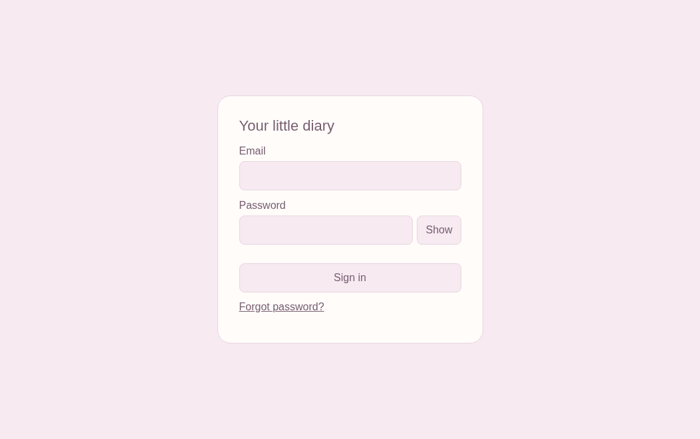

390 × 844:

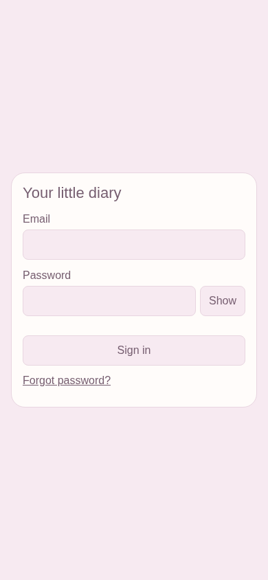

320 × 740:

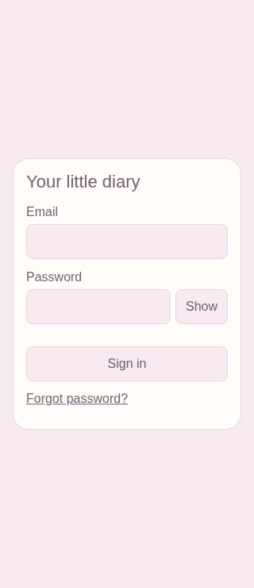

## Diary and all four themes

Sakura Pink, desktop:

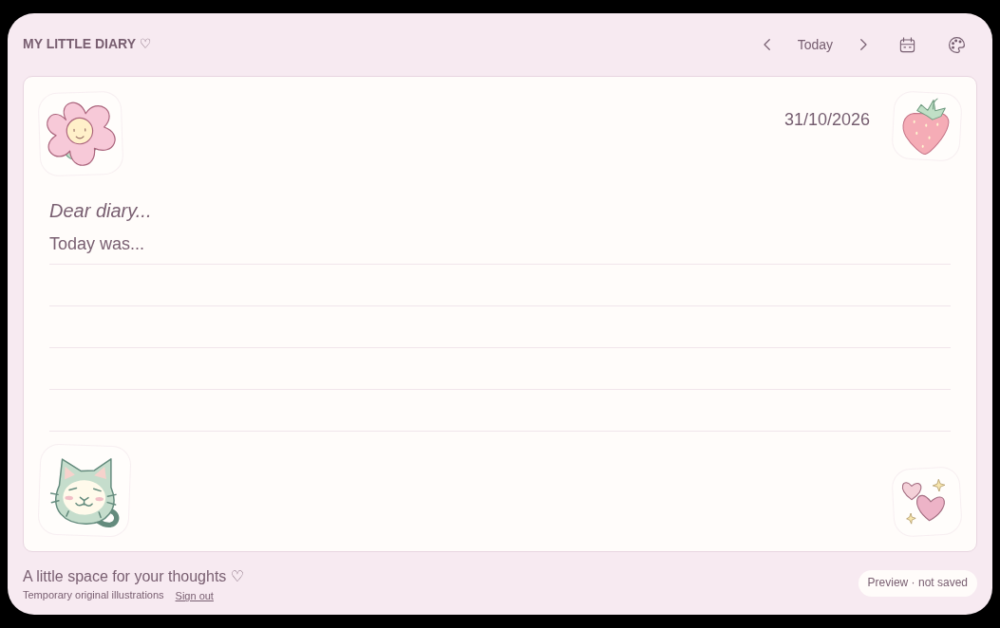

Dreamy Sky, desktop:

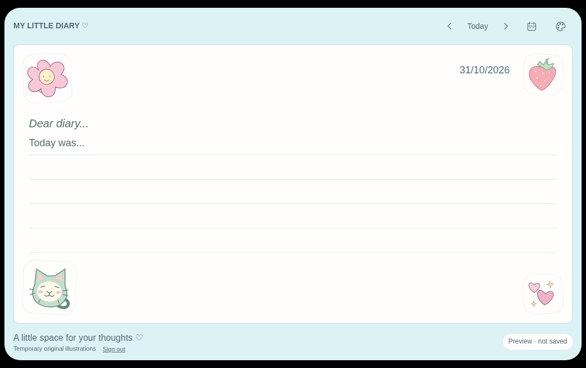

Lavender Dreams, desktop:

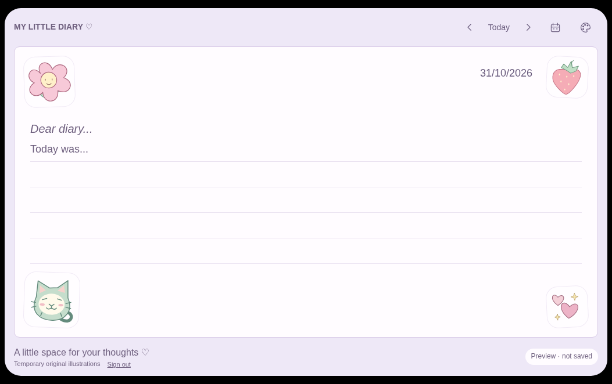

Vintage Journal, desktop:

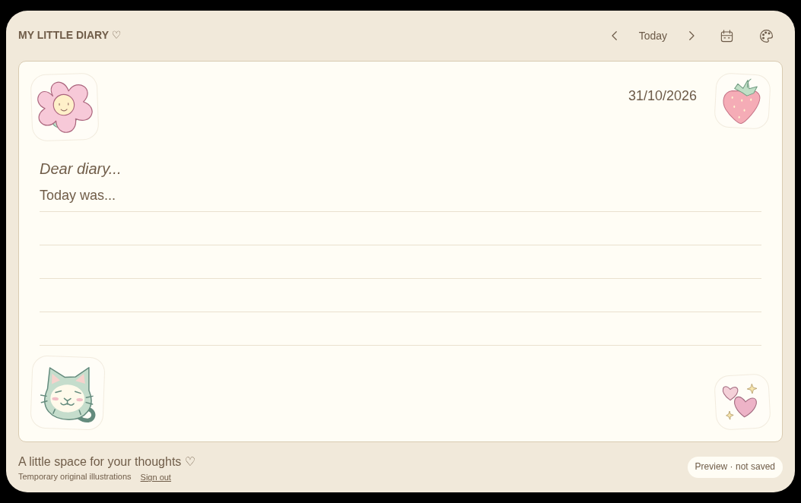

390 px Sakura Pink:

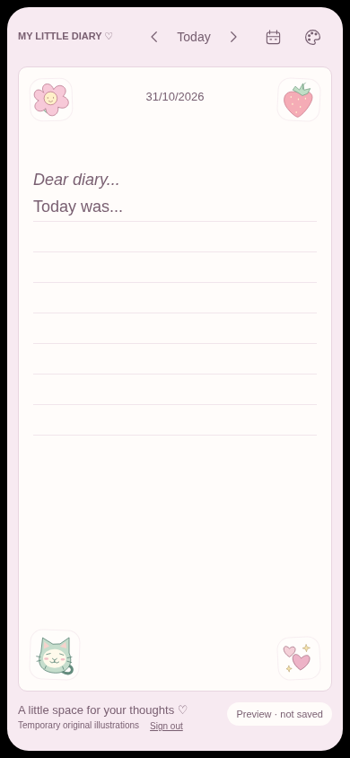

320 px Sakura Pink:

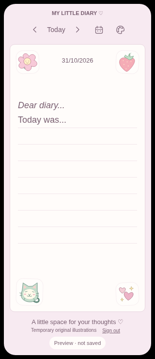

## Password recovery

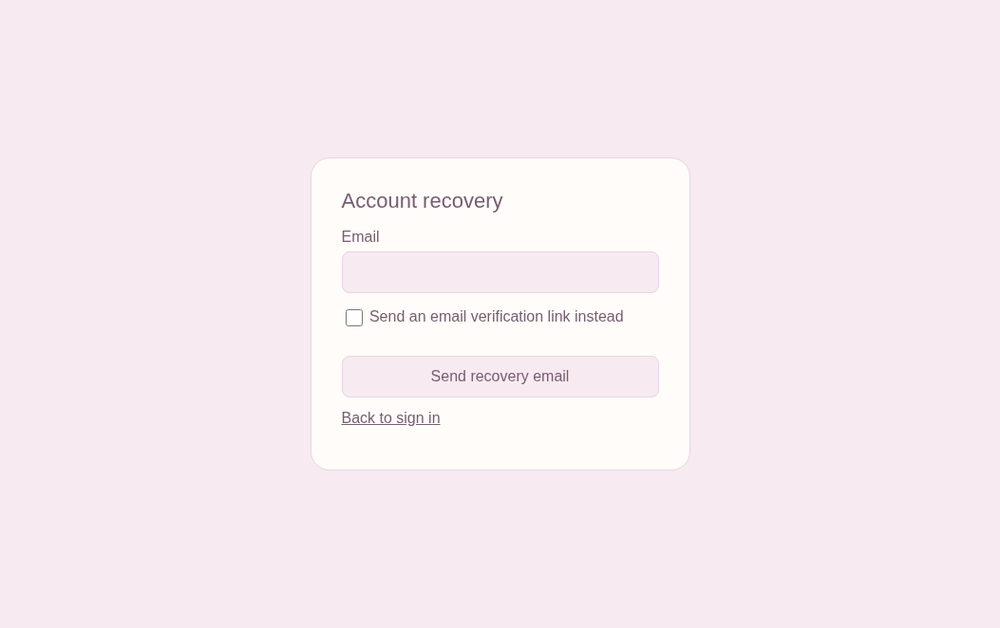

The form supports reset requests for the existing verified owner and verification-link requests for the existing bound account. Real email delivery is not configured or claimed.

## Reauthentication while writing

Before revocation, with clearly synthetic unsaved writing:

After the synthetic session is revoked, the original workspace is retained, hidden, inert and read-only behind this gate:

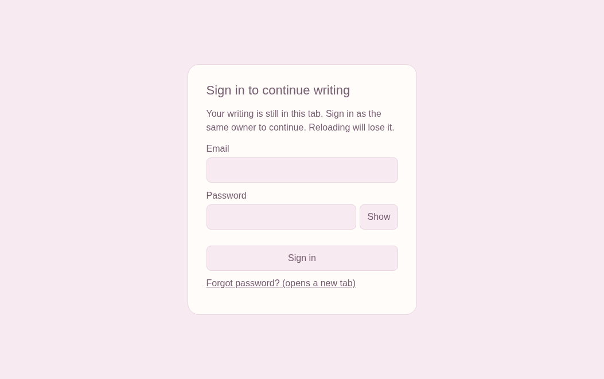

After same-owner login, the writing is restored in the same mounted workspace:

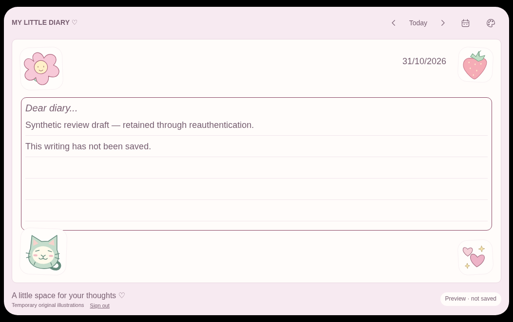

Separate browser assertions verify the original textarea node, backward selection, cursor, date and scroll restoration; a different verified identity cannot unlock the workspace. These screenshots demonstrate continuity, not durable storage. The status remains **Preview · not saved**.

## Comparison with the approved Phase 4 design

The authentication views are the necessary new Phase 5 surfaces. The diary retains its approved CSS, paper hierarchy, four-corner illustrations, date typography, navigation, rule spacing and themes. The necessary Sign out link is the intentional footer addition. No visual redesign was made during this security review.

Exact paper/editor geometry, rule spacing, overflow and header/paper pixel differences for the final regenerated views are recorded in [visual-comparison.json](../artifacts/phase-5/visual-comparison.json). Comparison excludes the footer containing Sign out. Differences confined to tiny antialiasing values on illustration edges are reported numerically rather than described as exact pixel matches.

Automated accessibility scans cover authentication/recovery forms, logout, calendar and all diary themes; mobile overflow, keyboard focus, selection and reflow assertions are included in the full Playwright suite. Results are in the updated security handoff and verification artifact.
